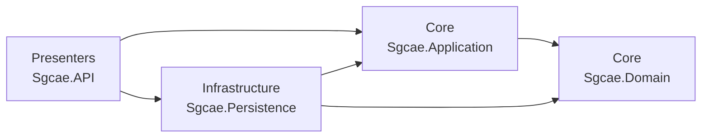
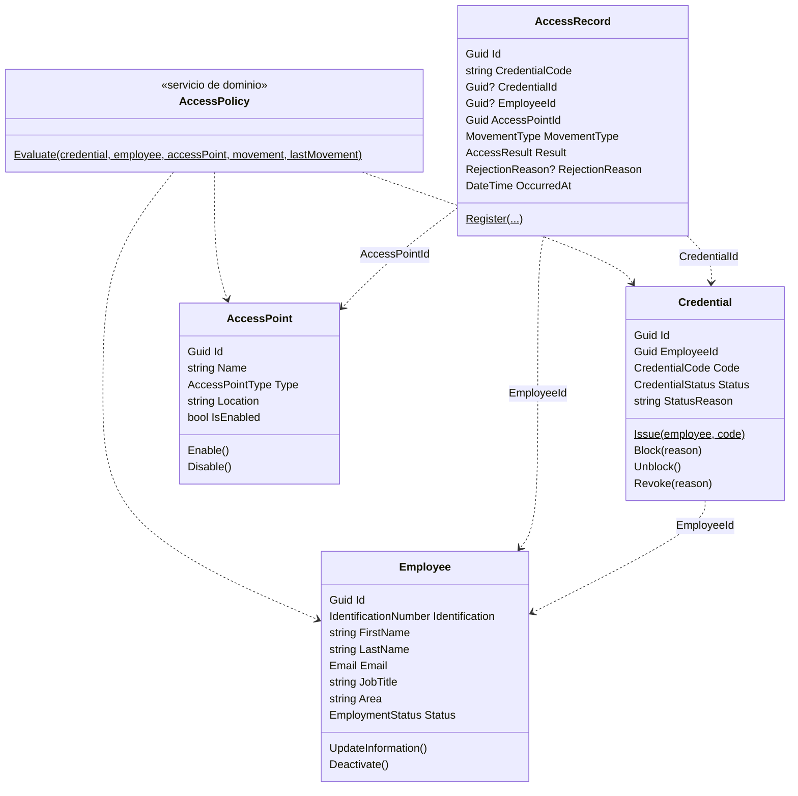
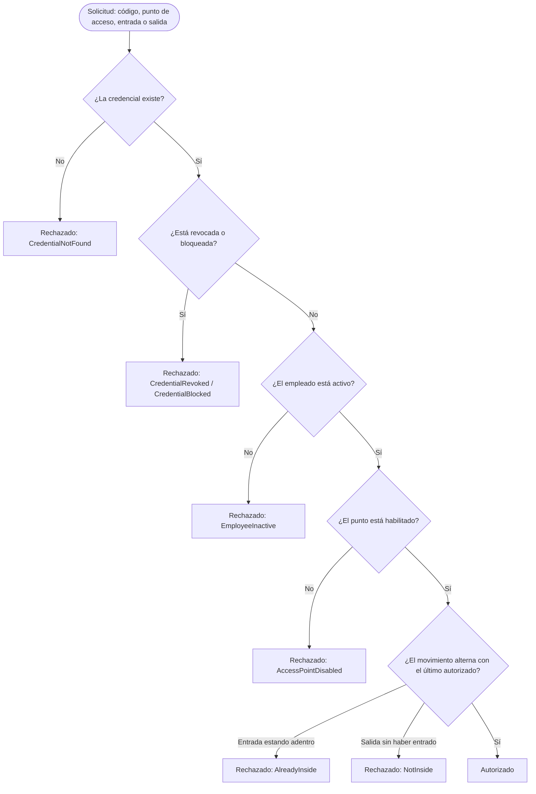

# SGCAE · Sistema de Gestión y Control de Acceso de Empleados

Backend con API REST para una empresa de servicios logísticos y de almacenamiento. Reemplaza las planillas
físicas y las hojas de cálculo de seguridad: administra a los empleados y sus credenciales, valida cada entrada
y salida en los puntos de acceso, y guarda un historial trazable de todos los intentos, autorizados o rechazados.

Seguimiento 2 de **Programación Distribuida**. Construido con **Clean Architecture**, **DDD** y **CQRS**,
sobre **ASP.NET Core Web API (.NET 10)**, **Entity Framework Core** y **SQL Server**.

**Autor:** Samuel Metaute Restrepo

## Arquitectura

La solución tiene cuatro proyectos de código y un proyecto de pruebas. Las dependencias apuntan siempre hacia el Dominio, que no depende de nada.



| Capa | Proyecto | Contenido |
|---|---|---|
| Dominio | `Sgcae.Domain` | Entidades, value objects, reglas de negocio y el servicio de dominio `AccessPolicy` |
| Aplicación | `Sgcae.Application` | Casos de uso con CQRS, mediador propio, DTOs, paginación y contratos de repositorio y Unit of Work |
| Persistencia | `Sgcae.Persistence` | `SgcaeDbContext`, configuraciones de EF Core, repositorios, Unit of Work y migraciones |
| Presentación | `Sgcae.API` | Controllers REST, manejo global de errores y documentación OpenAPI |

### Patrones

- **CQRS:** cada caso de uso es un *command* (cambia datos y confirma con el Unit of Work) o una *query* (solo lee).
  El historial de accesos tiene un repositorio de solo lectura (`IAccessHistoryReadRepository`) que proyecta
  directamente a DTOs, separado del repositorio de escritura de los registros.
- **Mediator:** los controllers solo conocen `IMediator`; `SimpleMediator` encuentra por reflexión el caso de uso de cada petición.
- **Repository y Unit of Work:** los contratos están en Aplicación y se implementan con EF Core en Persistencia.
- **Registro automático:** los casos de uso, los repositorios y las configuraciones de EF Core se descubren por reflexión,
  así que agregar uno nuevo no obliga a modificar archivos compartidos.

## Modelo de dominio

Cada agregado referencia a los demás solo por su Id. Ninguno tiene propiedades de navegación hacia otro agregado.



### Reglas e invariantes

| Agregado | Reglas |
|---|---|
| `Employee` | Identificación única, solo dígitos (5 a 15). Correo único y con formato válido. Nombres de 2 a 64 caracteres. Un empleado inactivo no se puede modificar ni desactivar de nuevo. La identificación no cambia. |
| `Credential` | Código único con formato `CRD-XXXXXXXX`, generado por el sistema. Solo se asigna a empleados activos y sin otra credencial vigente. Bloquear y revocar exigen un motivo de 5 a 200 caracteres. Una credencial bloqueada se puede desbloquear; una revocada no vuelve a usarse. |
| `AccessPoint` | Nombre único de 3 a 80 caracteres. No se habilita uno habilitado ni se inhabilita uno inhabilitado. |
| `AccessRecord` | Se crea una vez y no se modifica: es la traza de auditoría. Un acceso autorizado siempre tiene empleado y credencial. |

### Cómo se decide un acceso (RF-03)

`AccessPolicy` es un **servicio de dominio**: la regla involucra tres agregados (credencial, empleado y punto de acceso),
así que no le pertenece a ninguno de ellos. Evalúa en este orden y se detiene en el primer rechazo:



Todos los intentos, autorizados o rechazados, quedan registrados en `AccessRecords`. La última regla evita los
registros duplicados que tenían las planillas: no se aceptan dos entradas seguidas ni una salida sin entrada.

## Requerimientos funcionales y endpoints

Base: `http://localhost:5190`

| RF | Método | Ruta | Descripción |
|---|---|---|---|
| RF-01 | `POST` | `/api/employees` | Registra un empleado |
| RF-01 | `GET` | `/api/employees?search=&status=&area=&pageNumber=&pageSize=` | Lista paginada con búsqueda y filtros |
| RF-01 | `GET` | `/api/employees/{id}` | Detalle de un empleado |
| RF-01 | `PUT` | `/api/employees/{id}` | Actualiza un empleado activo |
| RF-01 | `PATCH` | `/api/employees/{id}/deactivate` | Desactiva el vínculo laboral |
| RF-02 | `POST` | `/api/credentials` | Asigna una credencial a un empleado (el código lo genera el sistema) |
| RF-02 | `GET` | `/api/credentials?employeeId=&status=` | Lista paginada de credenciales |
| RF-02 | `GET` | `/api/credentials/{code}` | Consulta una credencial y su estado |
| RF-02 | `PATCH` | `/api/credentials/{code}/block` | Bloquea la credencial, con motivo |
| RF-02 | `PATCH` | `/api/credentials/{code}/unblock` | Desbloquea la credencial |
| RF-02 | `PATCH` | `/api/credentials/{code}/revoke` | Revoca la credencial, con motivo |
| RF-03 | `POST` | `/api/access-requests` | Valida una entrada o salida y registra el resultado |
| RF-04 | `GET` | `/api/access-history?employeeId=&from=&to=&accessPointId=&result=` | Historial paginado con filtros |
| RF-06 | `POST` | `/api/access-points` | Registra un punto de acceso |
| RF-06 | `GET` | `/api/access-points?type=&isEnabled=` | Lista paginada de puntos de acceso |
| RF-06 | `GET` | `/api/access-points/{id}` | Detalle de un punto de acceso |
| RF-06 | `PATCH` | `/api/access-points/{id}/enable` | Habilita un punto de acceso |
| RF-06 | `PATCH` | `/api/access-points/{id}/disable` | Inhabilita un punto de acceso |

El enunciado no incluye un RF-05.

### Respuestas de error

Todos los errores usan el formato estándar **ProblemDetails**:

| Excepción | Código | Ejemplo |
|---|---|---|
| `BusinessRuleException` (regla del dominio) | 400 | "No se puede asignar una credencial a un empleado inactivo." |
| `ValidationException` (datos de la consulta) | 400 | "La fecha inicial no puede ser posterior a la fecha final." |
| `NotFoundException` | 404 | "No existe un empleado con el Id …" |
| `ConflictException` | 409 | "Ya existe un empleado registrado con la identificación 1037654321." |

Una solicitud de acceso rechazada **no** es un error: responde **201**, porque el intento queda registrado,
y el campo `result` indica `Denied` con su motivo.

## Cómo ejecutarlo

### Requisitos

- [.NET SDK 10](https://dotnet.microsoft.com/download/dotnet/10.0)
- SQL Server. Sirve **LocalDB**, que se instala con Visual Studio, o SQL Server en Docker.

### Pasos

```bash
git clone https://github.com/samrx21/sgcae.git
cd sgcae
dotnet run --project src/Presenters/Sgcae.API
```

En modo Development la API **crea la base de datos `SgcaeDb`, aplica las migraciones y carga cuatro puntos de acceso
de ejemplo** (recepción, parqueadero, bodega y sala de servidores). Luego abre **http://localhost:5190/scalar**.

### Usar SQL Server en Docker en lugar de LocalDB

```powershell
docker run -e "ACCEPT_EULA=Y" -e "MSSQL_SA_PASSWORD=Sgcae#2026" -p 1433:1433 -d mcr.microsoft.com/mssql/server:2022-latest
$env:ConnectionStrings__DefaultConnection = "Server=localhost,1433;Database=SgcaeDb;User Id=sa;Password=Sgcae#2026;TrustServerCertificate=True"
dotnet run --project src/Presenters/Sgcae.API
```

### Pruebas unitarias

```bash
dotnet test
```

El proyecto `tests/Sgcae.Tests` tiene 48 pruebas con xUnit. Cubren el servicio de dominio `AccessPolicy`
(cada motivo de rechazo y los accesos autorizados), las reglas de `Employee`, `Credential`, `AccessPoint` y `AccessRecord`,
los value objects y la validación de fechas del caso de uso del historial.

### Migraciones

```bash
dotnet tool restore
dotnet ef migrations add NombreDeLaMigracion --project src/Infrastructure/Sgcae.Persistence --startup-project src/Presenters/Sgcae.API --output-dir Migrations
dotnet ef database update --project src/Infrastructure/Sgcae.Persistence --startup-project src/Presenters/Sgcae.API
```

## Documentación y evidencias

- **Scalar (interactiva):** `http://localhost:5190/scalar`
- **OpenAPI:** `http://localhost:5190/openapi/v1.json`
- **Colección de Postman:** [`docs/postman/SGCAE.postman_collection.json`](docs/postman/SGCAE.postman_collection.json).
  La carpeta "1. Flujo de demostración" recorre todos los RF en orden y guarda los Ids en variables;
  "2. Errores de validación" muestra las reglas del dominio.
- **Archivos `.http`**, uno por RF: [`src/Presenters/Sgcae.API/Http`](src/Presenters/Sgcae.API/Http)
- **Evidencias de funcionamiento:** [`docs/evidencias.md`](docs/evidencias.md), con 46 peticiones reales y sus respuestas.
- **Pruebas unitarias:** [`tests/Sgcae.Tests`](tests/Sgcae.Tests), 48 pruebas que se ejecutan con `dotnet test`.

## Flujo de trabajo

El repositorio usa **Git Flow**: `main` guarda las versiones entregadas y `develop` integra el desarrollo.
Cada requerimiento funcional se desarrolló en su propia rama `feature/*` y se integró a `develop`.
La versión entregada se publicó con la rama `release/1.0.0`, fusionada en `main` con la etiqueta `v1.0.0`.

## Estructura

```
sgcae/
├── docs/
│   ├── evidencias.md
│   └── postman/SGCAE.postman_collection.json
├── Sgcae.sln
├── src/
│   ├── Core/
│   │   ├── Sgcae.Domain/          Entities, Services (AccessPolicy), Exceptions
│   │   └── Sgcae.Application/     UseCases (Commands / Queries), Contracts, Utilities
│   ├── Infrastructure/
│   │   └── Sgcae.Persistence/     Configurations, Repositories, Migrations
│   └── Presenters/
│       └── Sgcae.API/             Controllers, Requests, Middlewares, Http
└── tests/
    └── Sgcae.Tests/               Pruebas del dominio y de los casos de uso
```
